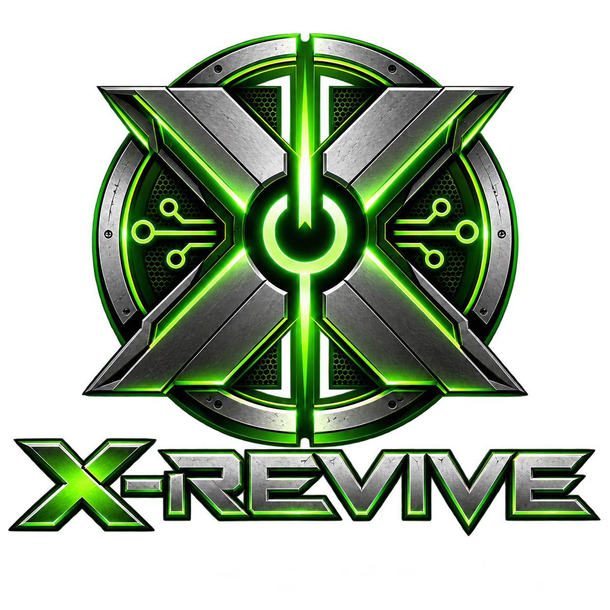

# X-Revive · Beta

## Download público e instalação

**[BAIXAR A IMG — beta.4 · 1,27 GB](https://github.com/jeanx360/X-Revive/releases/download/v0.1.0-beta.4/x-revive-v0.1.0-beta.4.img.xz)**

**[COMO GRAVAR E INSTALAR — guia passo a passo](docs/BAIXAR-E-INSTALAR.md)**

| Download | Para que serve |
|---|---|
| [IMG pronta (.img.xz)](https://github.com/jeanx360/X-Revive/releases/download/v0.1.0-beta.4/x-revive-v0.1.0-beta.4.img.xz) | Descompactar e gravar no pendrive; não precisa compilar |
| [Pastas do usuário (.zip)](https://github.com/jeanx360/X-Revive/releases/download/v0.1.0-beta.4/arquivos-do-usuario.zip) | Extrair na raiz da partição XREVIVE e colocar seus arquivos |
| [Checksums SHA256](https://github.com/jeanx360/X-Revive/releases/download/v0.1.0-beta.4/SHA256SUMS.txt) | Conferir a integridade do download |
| [Página da release e todos os arquivos](https://github.com/jeanx360/X-Revive/releases/tag/v0.1.0-beta.4) | Notas, fontes e avisos de licença |

Para gravar, recomendamos **[balenaEtcher](https://etcher.balena.io/)**.
[Outros aplicativos e instruções por sistema](docs/BAIXAR-E-INSTALAR.md#aplicativos-para-gravar-o-pendrive).
No GitHub, os botões **Code → Download ZIP** e os arquivos **Source code** baixam
os fontes, não a IMG instaladora. Use o download da IMG acima.

**Arquivos necessários:** `bios.bin` e `mcpx_1.0.bin`.
**EEPROM opcional:** forneça `eeprom.bin` para importar uma identidade existente;
sem esse arquivo, o Xemu gera uma EEPROM e o X-Revive a preserva no SSD.
[Como funciona](docs/EEPROM-OPCIONAL.md).

## Sobre o projeto

Um PC com experiência de Xbox Clássico: logo do projeto, animação Xbox e
dashboard, com áudio, rede, FTP e controle da bandeja física do DVD.
Linux fornece a base do sistema e o **Xemu** executa o console emulado.

**Versão dos fontes: `v0.1.0-beta.4`.** Projeto experimental para PC x86-64 com
boot UEFI. A instalação **apaga o HDD/SSD selecionado**, após duas confirmações.
Não é um instalador de dual boot com Windows/Linux nem uma migração de jogos.

<p align="center"></p>

## O que está disponível

- Uma mídia USB instaladora, com drivers Mesa e NVIDIA proprietário no mesmo sistema.
- Instalação da coleção Rocky5 pela internet ou de uma ISO local no formato X-Revive.
- XBMC4Gamers como dashboard padrão e outras dashboards acessíveis pela manutenção.
- HDD/SSD que inicia o PC sem o pendrive; jogos e aplicativos em FATX nativo.
- Uso do instalador por teclado **ou** controle, sem exigir os dois.
- Recuperação pelo USB e cliente de atualizações Xemu assinadas com reversão.

BIOS, MCPX, EEPROM, jogos e animação proprietária não são fornecidos.

Validado em bancada: inicialização, áudio, rede/FTP, instalação de jogos e
homebrew e abertura/fechamento da bandeja física. Consulte a
[matriz de validação](docs/BETA.md) para os testes e limites da beta.
Mantemos uma única imagem com Mesa e NVIDIA. Compatibilidade com Xbox físico
modchipado permanece experimental.

## Começar

1. Baixe a IMG na [release beta.4](https://github.com/jeanx360/X-Revive/releases/tag/v0.1.0-beta.4) e siga o [guia de gravação](docs/BAIXAR-E-INSTALAR.md). Não precisa compilar.
2. Descompacte `.img.xz` e grave a IMG no **pendrive inteiro**, de pelo menos 16 GB.
3. Na partição **XREVIVE**, coloque seus arquivos nesta estrutura:

   ```text
   XREVIVE/
     X-Revive/
       firmware/
         xbox/
           bios.bin
           mcpx_1.0.bin
           eeprom.bin        # opcional
         bootanims/Xbox/       # opcional: animação fornecida pelo usuário
           BootAnim.xbe
           bootanim.ini
       pacotes/               # opcional: ISO offline normalizada X-Revive
         sua-colecao.iso
   ```

4. Inicie pelo USB em UEFI. Escolha Rocky5 online (Ethernet/DHCP) ou ISO offline.
5. Após conferir os arquivos, selecione o destino, confira modelo/capacidade e
   confirme duas vezes. Ao terminar, retire o USB e inicie pelo HDD/SSD.

Leia o [guia completo de instalação](docs/INSTALADOR-ONLINE.md), inclusive o
espaço necessário para alternar online/offline em pendrive de 16 GB. **Uma ISO
original de HeXEn, OGXbox ou Rocky Extras Disc não substitui a ISO normalizada.**

## Controles

| Ação | Teclado | Controle |
|---|---|---|
| Navegar / selecionar / voltar | Setas / Enter / Esc | Digital / A / B |
| Confirmar apagamento | Segurar F10, soltar e repetir na segunda tela | Segurar LT+RT+Start, soltar e repetir |
| Manutenção no boot do SSD | Segurar R | Segurar Start+Back |
| Atualizador Xemu no boot | Segurar U | Segurar Y |
| Abrir menu do Xemu | Menu da aplicação | Start+digital para cima |

O cliente de atualização está implementado, mas o **canal público ainda não está
ativo**. Ele atualiza somente compilações X-Revive do Xemu; não atualiza kernel,
drivers, firmware ou coleção Rocky5.

## Documentação

- [Estado da beta, hardware e limitações](docs/BETA.md)
- [EEPROM opcional — próxima mudança aprovada](docs/EEPROM-OPCIONAL.md)
- [Instalação online, offline e diagnósticos](docs/INSTALADOR-ONLINE.md)
- [Build, testes e reprodução](docs/COMUNIDADE-BUILD.md)
- [Roadmap atual](docs/ROADMAP-BETA.md)
- [Notas v0.1.0-beta.4](docs/releases/v0.1.0-beta.4.md) e [changelog](CHANGELOG.md)
- [Atualizador Xemu](docs/ATUALIZADOR-XEMU.md) e [patch da bandeja](docs/XEMU-SMC-TRAY.md)
- [Licenças, terceiros e escopo da publicação](THIRD_PARTY_NOTICES.md) e [fontes da IMG](docs/FONTES-E-LICENCAS.md)
- [Como contribuir](CONTRIBUTING.md) e [relatar problemas](SECURITY.md)

Documentos de bancada datados preservam a evolução do projeto. Menções a três
variantes, HeXEn/OGXbox embutidos ou instalação offline embutida descrevem etapas
anteriores, substituídas pela mídia instaladora única desta beta.

## Estrutura

```text
cartucho/build/     receitas da imagem, catálogo fixado e patches Xemu
cartucho/overlay/   serviços, interface, instalador e atualizador
hal/               detecção e adaptação ao hardware
plataformas/xbox/  integração do Xbox com o sistema
bancada/           ferramentas de QA; discos, logs e capturas ficam locais
tests/             testes automatizados
docs/              guias atuais, decisões e relatórios históricos
```

Código original: **GPL-3.0-or-later**, com o escopo e as exceções descritos em
[LICENSE](LICENSE) e [NOTICE.md](NOTICE.md). Componentes e patches de terceiros
mantêm suas licenças. X-Revive é independente; não é um projeto oficial de
Microsoft, Xbox, Xemu, Rocky5 ou Cerbios.
