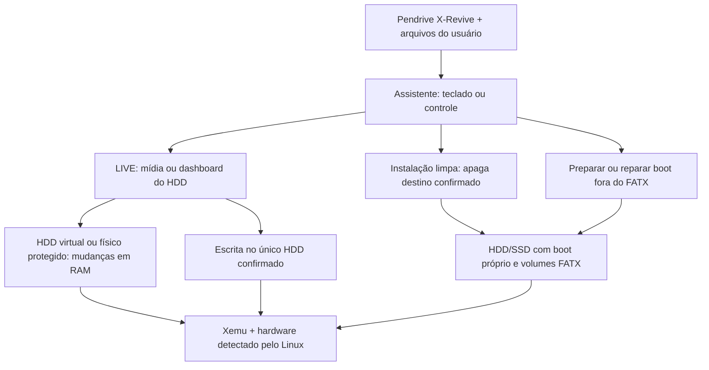

# Arquitetura atual — beta.5-live.6

Uma IMG para PC x86-64 UEFI reúne Linux mínimo, HAL, Mesa/NVIDIA, assistente
e Xemu com patches de bandeja/menu. [Guia](BAIXAR-E-INSTALAR.md).

O Xemu emula o Xbox; o X-Revive não executa XBE nativamente nem substitui a
necessidade de BIOS/MCPX compatíveis. EEPROM do usuário é opcional; se ausente,
o Xemu gera a identidade e o sistema a preserva. Firmware/ISOs privados não
acompanham a IMG.

## Pendrive e fontes

XREVIVE é exFAT de 10 GiB já formatada. Firmware em
`X-Revive/firmware/xbox/`, firmware do dongle em `firmware/dongle/` e mídias em
`X-Revive/pacotes/`. Os outros volumes de sistema não devem ser formatados.

A instalação limpa usa o catálogo Rocky5 online ou uma coleção normalizada
com `payload/manifest.json`. O LIVE também aceita imagens Xbox do usuário:
XDVDFS direta, partição Xbox de DVD completo e ISO9660 adaptável. A coleção
normalizada recebe menu próprio; não é o menu original do Extras Disc.

A adaptação offline usa NBD somente leitura: metadados em RAM e dados lidos
da ISO original, sem segunda cópia integral no USB. A receita determinística
é compartilhada com o gerador XISO; nomes de metadados FATX adaptados são
registrados, preservando seus conteúdos e a origem.

## Discos e boot

O assistente exclui o pendrive de origem, discos em uso e geometrias não
compatíveis. Discos internos/USB são protegidos por padrão; só um alvo é
liberado após as confirmações do modo com escrita. O hotplug recebe a mesma
proteção. O HDD híbrido expõe ao Xbox o prefixo Xbox, não a região Linux.

No LIVE protegido, loop somente leitura e overlay qcow2 em RAM mantêm o HDD
físico intacto; alterações são perdidas ao desligar. Os limites atuais são
512 MiB de alterações em HDD físico ou 1 GiB em HDD virtual temporário.

Preparar/reparar boot é separado da instalação limpa. Pode atualizar SYSTEM
e UEFI preservando os volumes FATX quando existe mapa/reserva fora deles.
Rodapé pode ser recuperado pelo mapa da ESP. Ausência de inventário de apps
não impede LIVE/reparo. Se F ocupa até o final, a candidata não reduz F
sozinha; isso exige migração específica. [Detalhes](PRESERVACAO-HDD.md).

## Interface, entrada e rede

RPC de controle e consulta de status usam canais independentes; o desenho
não espera subprocessos de configuração. Operações têm identificador próprio,
etapas/tempo e histórico; animação não é prova de avanço. Preparação pode ser
cancelada cooperativamente, e configuração de hardware tem prazo de 90 s.
Etapas são registradas no USB sem senhas/argumentos.

Wi-Fi pessoal é configurado por NetworkManager com conexão temporária. Ethernet
continua no systemd-networkd. Xemu usa Ethernet/pcap quando há cabo ativo e NAT
quando necessário, incluindo saída pela conexão Wi-Fi do host. Isso não equivale
a ponte Ethernet sobre Wi-Fi; FTP externo por esse caminho tem teste específico
pendente. Firmware do dongle é importado antes do assistente e preservado no SSD.

| Ação | Teclado | Controle |
|---|---|---|
| Navegar, escolher, voltar | Setas, Enter, Esc | Digital, A, B |
| Confirmar escrita/boot | Segurar F10, soltar e repetir | LT+RT+Start, soltar e repetir |
| Detalhes durante preparação | F1 | X |
| Cancelar preparação permitida | Esc | B |
| Manutenção no boot do SSD | R | Start+Back |
| Cliente de atualização Xemu | U | Y |
| Menu do Xemu | Menu da aplicação | Start+digital para cima |

O cliente Xemu tem assinatura/reversão; canal público ainda não ativo. Não
atualiza o sistema integral, kernel ou driver.

## Código e evidências

`cartucho/build/` contém receitas e patches; `cartucho/overlay/` contém runtime,
UI, instalador e atualizador; `hal/` e `plataformas/xbox/` integram o hardware;
`bancada/` e `tests/` validam comportamentos. Scripts de bancada não são tutoriais
para discos pessoais. [Resultados](VALIDACAO-LIVE6-RECUPERACAO.md),
[requisitos](COMPATIBILIDADE.md) e [roadmap](ROADMAP-ATUAL.md).
